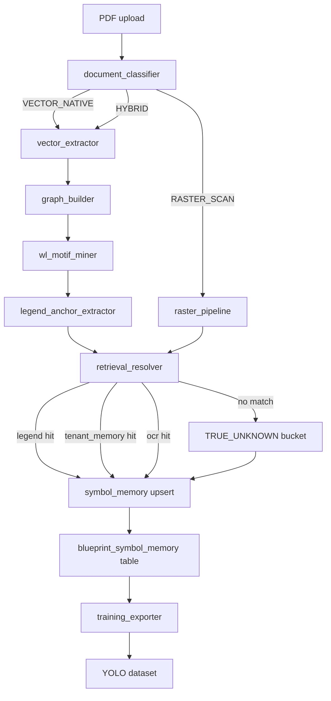
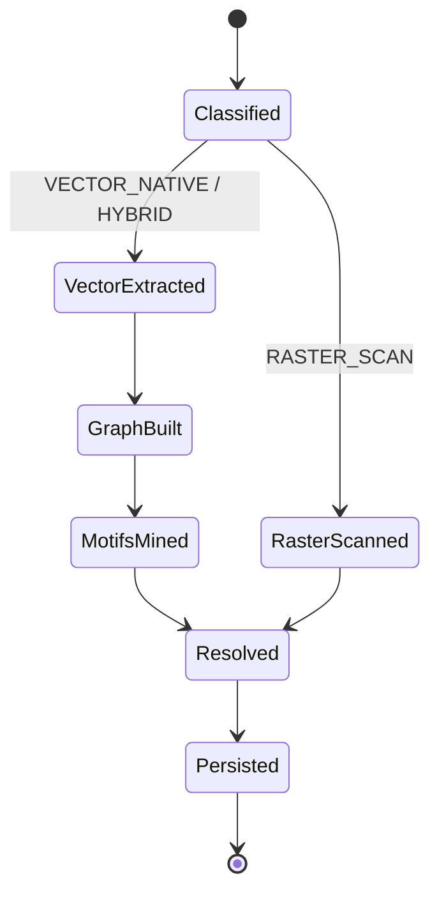
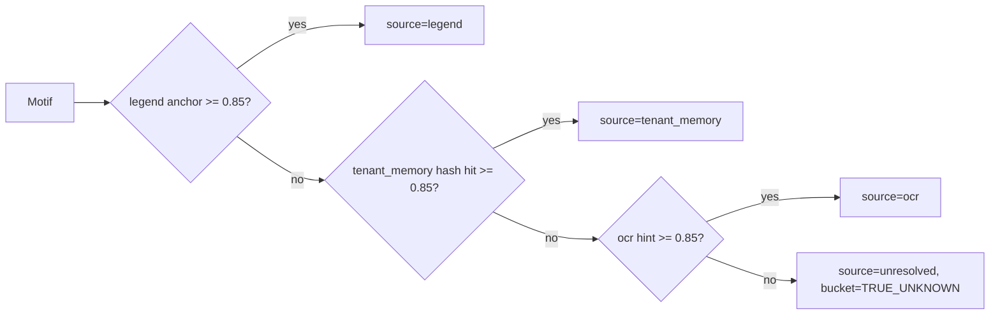
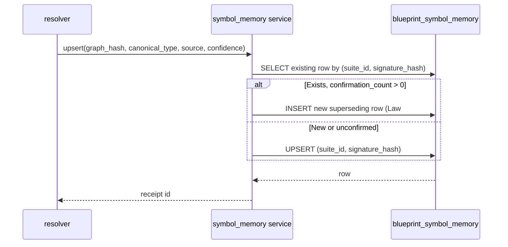

# Wave 11g-v2 — Execution Flow

## End-to-end pipeline



## Per-page state machine



## Resolver layered retrieval (Law #3 fail closed)



## Persistence write path



## YOLO export pipeline

```mermaid
flowchart TD
    A[export_yolo_dataset call] --> B[load rows from blueprint_symbol_memory]
    B --> C{source in {legend, confirmation, tenant_memory}?}
    C -->|no| X1[exclude: wrong_source]
    C -->|yes| D{confidence >= 0.85?}
    D -->|no| X2[exclude: low_confidence]
    D -->|yes| E{source=legend OR confirmations >= 1?}
    E -->|no| X3[exclude: insufficient_confirmations]
    E -->|yes| F{graph_hash already seen?}
    F -->|yes| X4[exclude: duplicate_graph_hash]
    F -->|no| G[shuffle + split 70/20/10]
    G --> H[write images/, labels/, data.yaml, manifest.json]
```
